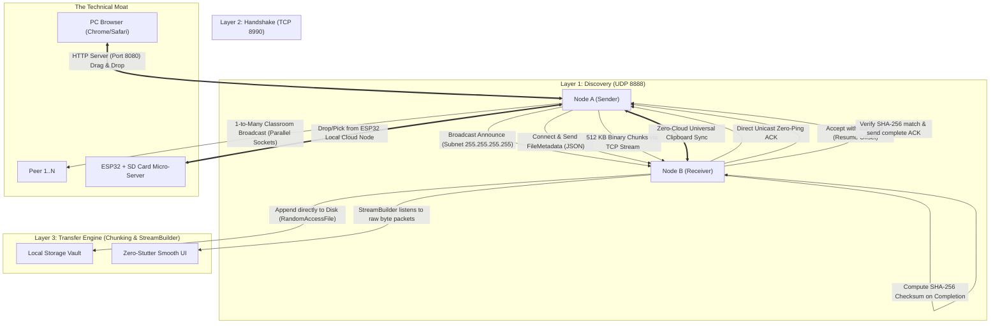

# ZeroPing Core Architecture & Developer Guide

> **Tagline:** Zero Server. Zero Latency. Pure Sockets.  
> **Platform Target:** Android & Windows / Desktop Cross-Platform (No iOS Wi-Fi direct limitations)

---

## 1. Architectural Overview & Data Flow



---

## 2. Core UI/UX Layout (Dark Glassmorphism)

### Radar Screen (Home):
- **Clutter-Free Visuals:** Clean concentric animated sonar rings and continuous 360° radar sweep.
- **Two Dominant Action Focuses:**
  - **`SEND` (Cyan Glow Pill):** File picker selection + peer destination target selector.
  - **`RECEIVE` (Violet Glow Pill):** Instant listen mode making device discoverable and ready for incoming socket handshakes.
- **Quick Action Dock:**
  - 🌐 **Browser Drop:** Launches phone's local HTTP server for PC-to-Phone drag-and-drop.
  - 📋 **Universal Clipboard:** Instant text/OTP copy-paste sync over local network.
  - 💾 **Hardware Node:** Connects to physical/virtual ESP32 offline drive.

### Transfer Queue Tab:
- Direct **Dart `StreamBuilder`** binding to the TCP socket byte streams.
- Smooth real-time progress update without triggering heavy `setState` re-renders or freezing the Flutter UI thread.
- Full pause/resume control with byte offset tracking.

### File Explorer / Vault:
- In-app file manager automatically categorizing files into: **Videos, Images, Documents, APKs, Audio**.
- 1-tap open with OS viewer (`open_filex`) or direct re-share to nearby peers.

### Settings & Network Stats:
- Node name customization and port diagnostics.
- **Hidden Dev Mode / Advanced Stats Toggle:**
  - Live socket ping latency (`< 1 ms`).
  - Active packet loss (`0.0%`).
  - Active connected sockets count.
  - TCP chunk buffer depth.

---

## 3. Killer Options (The Technical Moat)

### 1. Browser Drop (PC to Mobile Sync)
- **Problem Solved:** Transferring files from PC to phone usually requires USB cables, cloud uploads, or installing desktop companion apps.
- **Solution (`lib/services/browser_drop_service.dart`):**
  - App hosts an embedded local HTTP server on port `8080`.
  - PC user opens `http://<phone-ip>:8080` in Chrome/Safari/Edge.
  - Dark glassmorphism web interface allows:
    1. Drag-and-drop file upload directly to phone storage.
    2. Browsing and downloading Phone Vault files to PC with 1 click.
    3. Pushing clipboard text / OTPs directly from PC to phone.

### 2. Auto-Resume Logic (Byte-Level Resuming)
- Incomplete downloads are never deleted.
- Receiver reads partial file length: `final existingBytes = partialFile.lengthSync();`.
- Handshake returns `startByte: existingBytes`.
- Sender calls `raf.setPosition(startByte)` and streams only the remaining bytes!

### 3. Selective OS Permissions Manager (Android 13+ Compliance)
- Educational onboarding modal explains:
  *"Location permission is strictly required by Android OS for Wi-Fi P2P SSID scanning. ZeroPing collects ZERO GPS coordinates, maps, or cellular tracking."*

### 4. 1-to-Many Multi-Broadcast (Classroom / Agency Mode)
- **File:** [`lib/services/broadcast_engine.dart`](file:///Users/piyush/Documents/p2p-chatting/lib/services/broadcast_engine.dart)
- Parallel TCP socket streaming: A heavy file (PDF/video) is read from disk **once** in 512KB chunks and pushed to $N$ connected peers simultaneously.
- Zero redundant disk reads, maximizing local network throughput for meetings, schools, and design agencies.

### 5. Zero-Cloud Universal Clipboard
- **File:** [`lib/services/clipboard_service.dart`](file:///Users/piyush/Documents/p2p-chatting/lib/services/clipboard_service.dart)
- Automatically synchronizes copied text, links, or OTPs between phone and PC across local sockets.
- Zero internet, zero cloud servers, zero latency.

### 6. Hardware "Local Cloud" Node (ESP32 Integration)
- **Firmware:** [`esp32_firmware/esp32_cloud_node.ino`](file:///Users/piyush/Documents/p2p-chatting/esp32_firmware/esp32_cloud_node.ino)
- **Service:** [`lib/services/iot_node_service.dart`](file:///Users/piyush/Documents/p2p-chatting/lib/services/iot_node_service.dart)
- Connects an ESP32 microcontroller + MicroSD card module directly to the office/classroom router.
- Acts as a local, offline Google Drive: users can **"Drop to Node"** and **"Pick from Node"** without needing an active internet connection.

---

## 4. Source Code Structure
```
lib/
├── main.dart                          # Application entry point & service bootstrap
├── models/
│   ├── peer_device.dart               # Discovered peer model & OS categorization
│   ├── file_metadata.dart             # Handshake metadata & chunk sizes
│   ├── transfer_task.dart             # Task metrics (speed, progress, ETA, SHA-256)
│   └── chat_message.dart              # Walkie-talkie chat message model
├── services/
│   ├── network_utils.dart             # Local IP & subnet broadcast calculation
│   ├── discovery_service.dart         # UDP broadcast & instantaneous ACK
│   ├── p2p_socket_service.dart        # TCP ServerSocket, Client pool & wire protocol
│   ├── browser_drop_service.dart      # Local HTTP web server for PC-to-Phone sync
│   ├── clipboard_service.dart         # Zero-Cloud universal clipboard sync
│   ├── broadcast_engine.dart          # 1-to-Many Classroom multi-peer broadcast
│   ├── iot_node_service.dart          # ESP32 offline drive client & simulator
│   ├── permission_service.dart        # Android 12+ permission handling & diagnostics
│   └── storage_service.dart           # Persistence for history, downloads & node settings
├── transfer/
│   └── transfer_engine.dart           # Chunked stream reader, disk writer & SHA-256
├── theme/
│   └── app_theme.dart                 # Futuristic glassmorphism tokens & cyberpunk accents
├── widgets/
│   ├── glass_container.dart           # Frosted glass card with luminous border
│   ├── radar_scanner.dart             # Animated radar sweep canvas & interactive nodes
│   ├── transfer_progress_card.dart    # Live speed, ETA, SHA-256 & resume controls
│   └── permission_banner.dart         # Android 12+ permission status checker
└── screens/
    ├── home_screen.dart               # Bottom navigation stack & file acceptance modal
    ├── radar_screen.dart              # Clutter-free Radar with giant SEND & RECEIVE buttons
    ├── transfers_screen.dart          # StreamBuilder real-time transfer queue
    ├── chat_screen.dart               # Serverless Walkie-Talkie P2P chat
    ├── files_screen.dart              # In-app file explorer vault (Images, Videos, Docs, APKs)
    └── settings_screen.dart           # Dev Mode, Packet Loss & Selective Permissions
```
