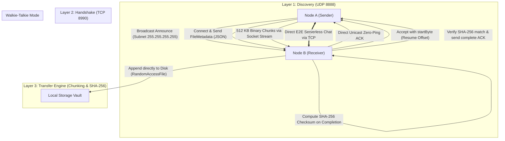

# ZeroPing Core Architecture & Developer Guide

> **Tagline:** Zero Server. Zero Latency. Pure Sockets.  
> **Platform Target:** Android & Windows / Desktop Cross-Platform (No iOS Wi-Fi direct limitations)

---

## 1. Architectural Overview & Data Flow



---

## 2. Layer 1: Discovery Layer (UDP Broadcasting)
- **Problem Solved:** No cloud server and typing IP addresses manually is bad UX.
- **Protocol:** `RawDatagramSocket` on UDP port `8888`.
- **Broadcast:** Pings subnet broadcast (e.g. `192.168.43.255` & `255.255.255.255`).
- **Zero-Ping ACK:** Whenever a receiver hears a discovery announcement, it immediately returns a direct unicast UDP ACK packet to the sender's IP. Both nodes instantly register on the Radar without waiting for the next periodic scan cycle.
- **Fail-Safe Fallback:** If an enterprise Wi-Fi or router isolates UDP broadcast packets, the UI provides a **"Manual Direct IP Connect"** modal to connect directly to `IP:8990`.

### The Android 12+ Trap Handled:
In Android 12+ (API 31/32/33+), discovery and socket access fail silently if permissions are not strictly handled:
- `android.permission.NEARBY_WIFI_DEVICES` (with `android:usesPermissionFlags="neverForLocation"`)
- `android.permission.BLUETOOTH_SCAN`
- `android.permission.BLUETOOTH_CONNECT`
- `android.permission.ACCESS_FINE_LOCATION`
- `android.permission.READ_MEDIA_IMAGES / VIDEO / AUDIO`
- Handled in `lib/services/permission_service.dart` with a diagnostic banner and one-tap **"Grant All"** flow.

---

## 3. Layer 2 & 3: Connection & Transfer Engine (TCP Socket Wire Protocol)
- **Port:** `8990` (`ServerSocket.bind(InternetAddress.anyIPv4, 8990)`).
- **Packet Framing:**
  - `0x01` (JSON Control Message):
    - 1 byte `msgType = 0x01`
    - 4 bytes `uint32 big-endian` JSON payload length
    - UTF-8 JSON payload (`chat`, `file_offer`, `file_accept`, `file_reject`, `file_complete`, `file_complete_ack`)
  - `0x02` (Binary File Chunk):
    - 1 byte `msgType = 0x02`
    - 36 bytes UTF-8 `fileId`
    - 8 bytes `uint64 big-endian` `offset`
    - 4 bytes `uint32 big-endian` `chunkLength`
    - Raw binary byte stream payload ($M$ bytes)

### Zero RAM Bloat (OOM Protection):
- Files of any size (e.g., 2 GB – 50 GB) are read in **512 KB chunks** using `RandomAccessFile`.
- Stream backpressure is maintained using `socket.flush()` so that heap memory usage remains constant (< 20 MB) during multi-gigabyte transfers.
- The receiver writes chunks directly to disk via `RandomAccessFile.setPosition(offset)` and `writeFrom()`.

---

## 4. Layer 4: Checksum & Resume Logic (The Technical Moat)
1. **Streaming SHA-256 Verification:**
   - Hash is computed chunk-by-chunk using `crypto.sha256.bind(file.openRead())`.
   - Verified on both sender and receiver upon transfer completion.
2. **Byte-Level Resuming:**
   - If Wi-Fi disconnects or connection drops, the receiver records the existing partial file size on disk (`partialFile.lengthSync()`).
   - On reconnection, receiver replies to the file offer with `startByte: existingLength`.
   - Sender seeks directly to `existingLength` using `raf.setPosition(startByte)` and resumes pushing remaining chunks without restarting from 0%.

---

## 5. Walkie-Talkie Mode (Local Chat)
- Serverless peer-to-peer real-time chat over TCP socket.
- Zero latency (local ping).
- Messages stored in local persistent storage (`StorageService`).
- Direct file attachment button inside chat thread.

---

## 6. Directory Structure
```
lib/
├── main.dart                          # Application entry point & service bootstrap
├── models/
│   ├── peer_device.dart               # Discovered peer model & OS categorization
│   ├── file_metadata.dart             # Handshake metadata & chunk sizes
│   ├── transfer_task.dart             # Task metrics (speed, progress, ETA, SHA-256)
│   └── chat_message.dart              # Walkie-talkie chat message model
├── services/
│   ├── network_utils.dart             # Local IP & subnet broadcast calculation
│   ├── discovery_service.dart         # UDP broadcast & instantaneous ACK
│   ├── p2p_socket_service.dart        # TCP ServerSocket, Client pool & wire protocol
│   ├── permission_service.dart        # Android 12+ permission handling & diagnostics
│   └── storage_service.dart           # Persistence for history, downloads & node settings
├── transfer/
│   └── transfer_engine.dart           # Chunked stream reader, disk writer & SHA-256
├── theme/
│   └── app_theme.dart                 # Futuristic glassmorphism tokens & cyberpunk accents
├── widgets/
│   ├── glass_container.dart           # Frosted glass card with luminous border
│   ├── radar_scanner.dart             # Animated radar sweep canvas & interactive nodes
│   ├── transfer_progress_card.dart    # Live speed, ETA, SHA-256 & resume controls
│   └── permission_banner.dart         # Android 12+ permission status checker
└── screens/
    ├── home_screen.dart               # Bottom navigation stack & file acceptance modal
    ├── radar_screen.dart              # Radar hub, scanning toggle, manual IP connect
    ├── transfers_screen.dart          # Active, paused & completed transfer tasks
    ├── chat_screen.dart               # Serverless Walkie-Talkie P2P chat
    ├── files_screen.dart              # In-app file explorer vault & quick sender
    └── settings_screen.dart           # Node identity, port diagnostics & permissions
```
