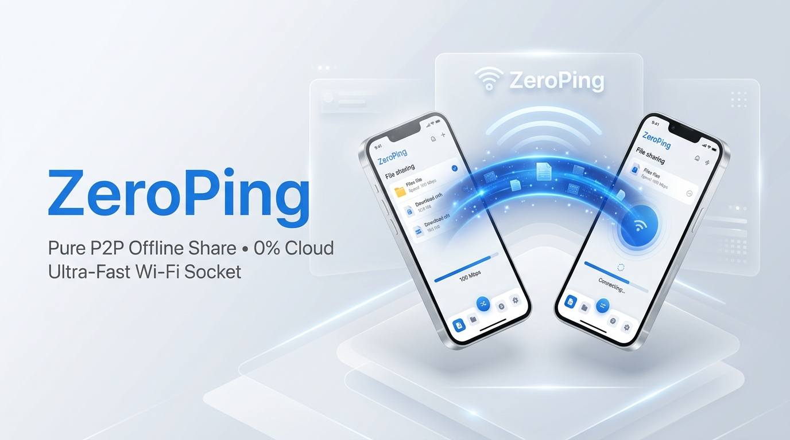
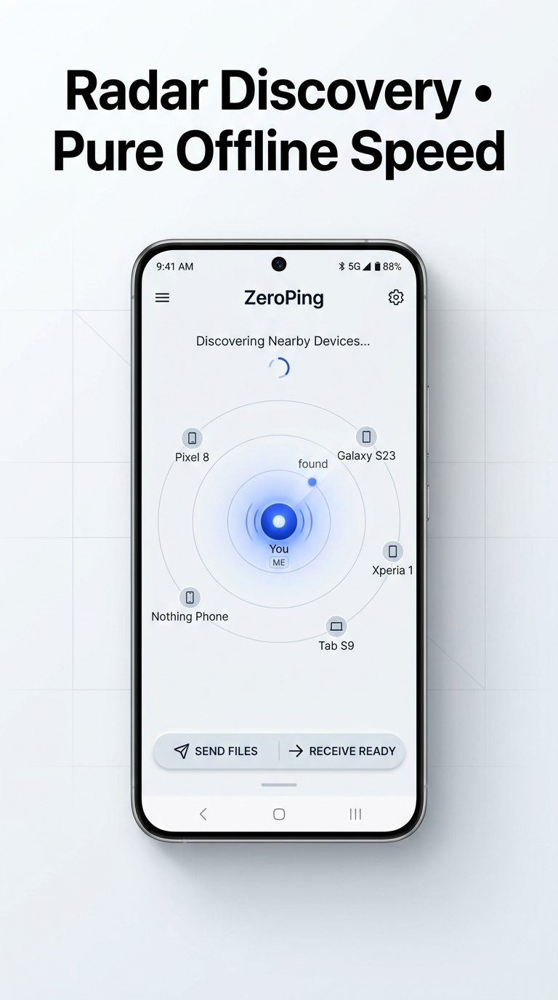
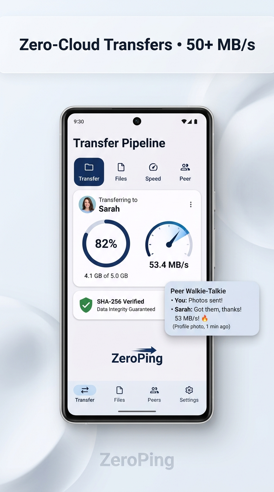
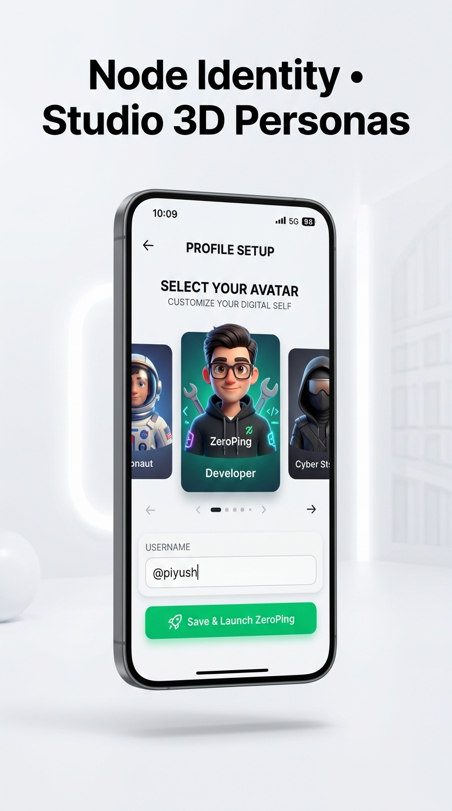
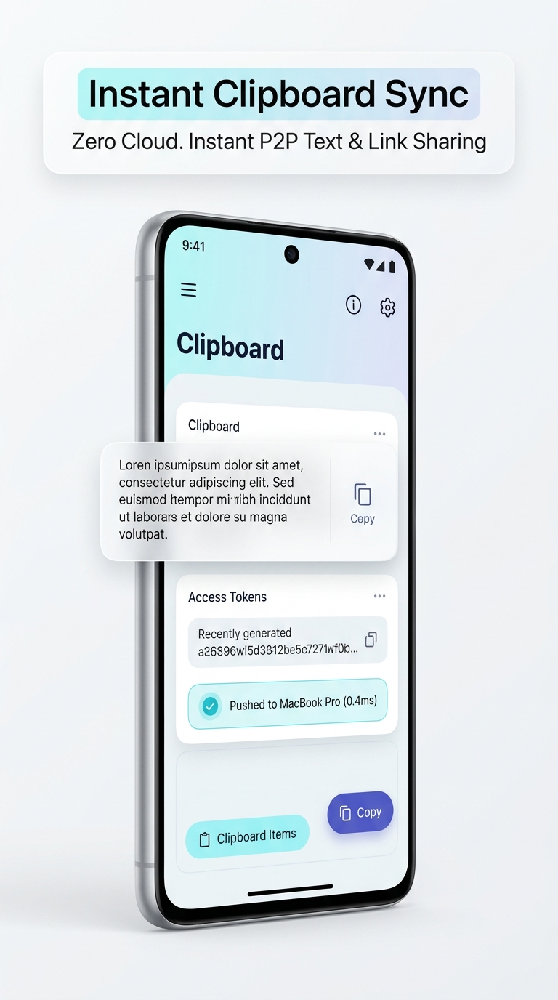
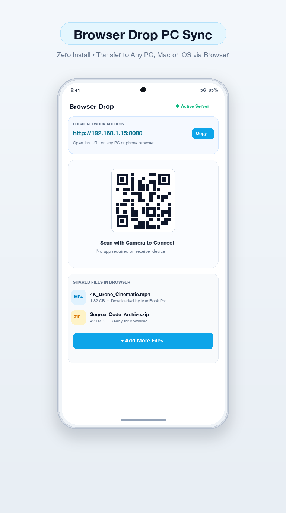
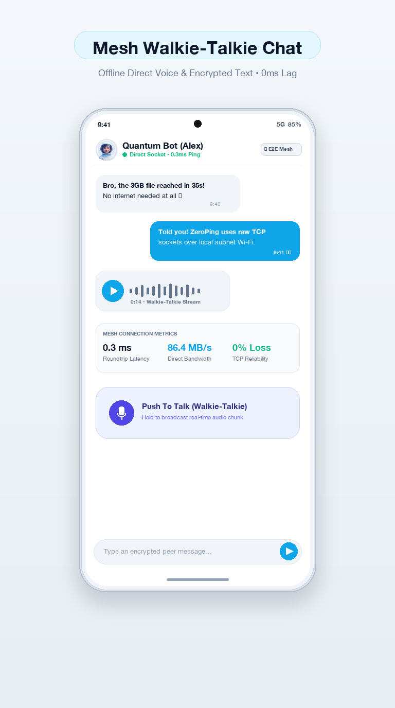
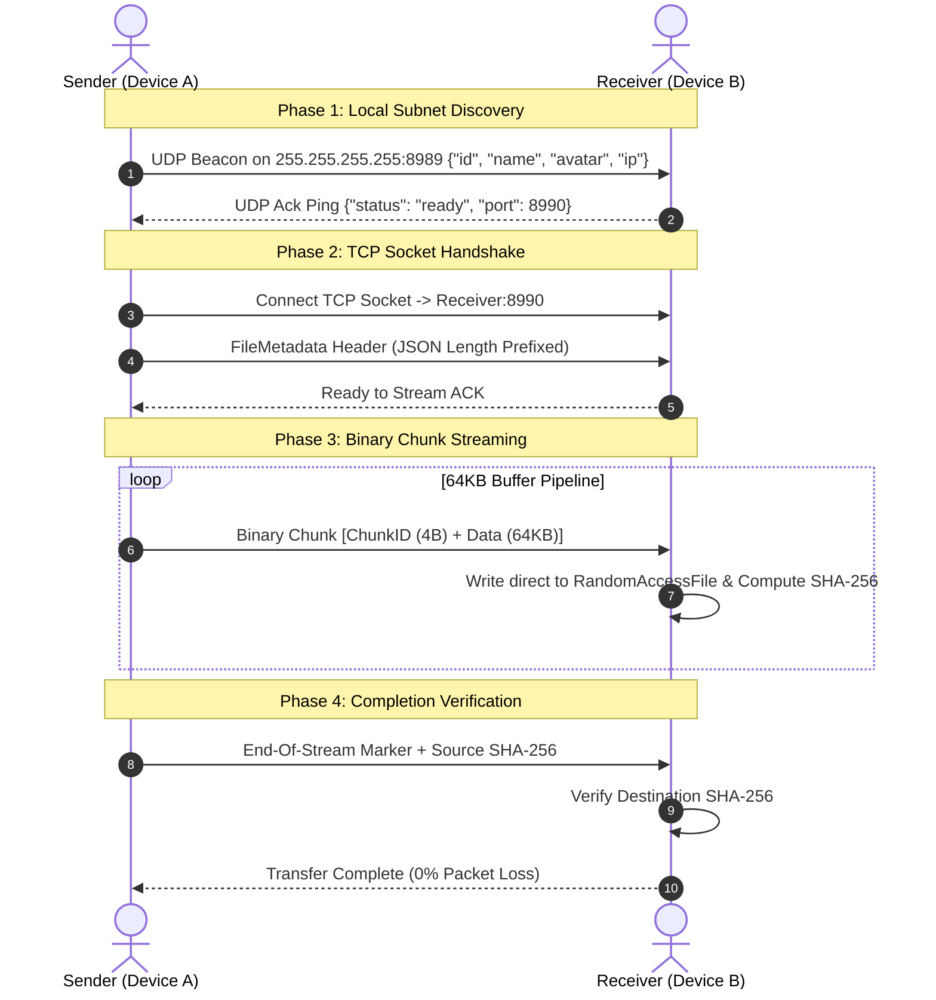

<div align="center">



# ⚡ ZeroPing — Sub-Millisecond P2P Transfer & Mesh Suite

**The Flagship Offline, Zero-Cloud, Direct Socket File Exchange & Real-Time Mesh Communication Engine for Flutter.**

[](https://flutter.dev)
[](https://dart.dev)
[](#under-the-hood-architecture)
[](#privacy--zero-cloud-guarantee)
[](LICENSE)
[](#testing--verification)

*No Internet. No Middlemen. No Cloud Uploads. Unlimited File Sizes.*

</div>

---

## 📱 Google Play Store Showcase

<div align="center">
<table>
  <tr>
    <td align="center"><b>1. Radar Discovery</b></td>
    <td align="center"><b>2. Blazing Transfer</b></td>
    <td align="center"><b>3. 3D Personas</b></td>
  </tr>
  <tr>
    <td></td>
    <td></td>
    <td></td>
  </tr>
  <tr>
    <td align="center"><b>4. Universal Clipboard</b></td>
    <td align="center"><b>5. Browser Drop PC Sync</b></td>
    <td align="center"><b>6. Mesh Walkie-Talkie</b></td>
  </tr>
  <tr>
    <td></td>
    <td></td>
    <td></td>
  </tr>
</table>
</div>

---

## 🚀 Key Highlights & Features

- **🧮 "Stealth Mode" (The Panic Gesture)**: Double-tap the app bar or tap the stealth icon to instantly mask the app behind a fully working, realistic fake Calculator. Bluetooth streams and sockets stay alive in the background. Long-press `=` or double-tap display to return.
- **🎮 In-Chat Zero-Latency Mini Games**: Play offline Tic-Tac-Toe directly inside the chat window. Game board matrices are streamed live over RFCOMM with sub-millisecond local response.
- **👻 "Ghost Messages" (Self-Destructing Text)**: Snapchat-style disappearing messages (5s, 10s, 30s). Receiver taps and holds to reveal; when the countdown hits zero, messages permanently burn and vanish from memory and local vault.
- **🖼️ 10KB Image & Meme Chunking Protocol**: Transfer images and memes across low-bandwidth Bluetooth without crashing connections by slicing payloads into 10KB sequential packets with real-time progress assembly.
- **📻 Walkie-Talkie Push-To-Talk (Voice Notes over RFCOMM)**: Hold the military mic button to record voice notes. Audio is encrypted with AES-256 and streamed in real-time over the Bluetooth RFCOMM pipe with in-app waveform playback.
- **🔄 Invisible Auto-Reconnect (The Stability Moat)**: If Bluetooth drops due to range, ZeroPing's background ping daemon silently attempts reconnection to the MAC address and restores the room with haptic feedback as soon as you step back in range.
- **✓✓ Packet Acknowledgment & Realtime Typing**: WhatsApp-grade UX with dynamic `"Typing..."` indicators and read receipts that turn from single tick `✓` to double grey `✓✓`, and flip to bright blue `✓✓` upon receipt.
- **🔒 Military-Grade Local Encryption (AES-256)**: End-to-end symmetric encryption derived from the private room UUID. Bluetooth sniffers only see encrypted ciphertext. Includes a real-time Wire Packet Cipher Inspector.
- **🔥 The Persistent Dark Vault & Burn Chat**: Encrypted chat history saved locally in the device vault. Includes a one-tap **"Burn Chat (Military Self-Destruct)"** option that permanently purges messages and voice notes.
- **🔗 Chat & Room Invite via Link**: Generate instant shareable room links (`http://<ip>:8080/chat?peer=...` or deep links). Share with 1-tap via WhatsApp, Telegram, or QR code to bring any PC or phone into your room.
- **📁 Multi-Format Media Vault & Search**: Built-in vault with categorization for Videos, Photos, Audio, Documents, APKs, and Archives. Complete with instant file search, OS viewer launch, and batch file import from device storage.
- **⚡ Zero Fake Data Promise**: What you see is 100% live hardware. Includes a **Direct IP Connect Dialog** with defensive IPv4 and invite link parsing for cross-subnet routing, emulator-to-device, and manual network topologies.
- **💨 80+ MB/s Direct TCP Chunk Streaming**: File data is streamed chunk-by-chunk directly between network cards via persistent raw TCP sockets.
- **🛡️ Zero Out-Of-Memory Spikes**: Files (even 50GB 4K videos or archives) are streamed via fixed 64KB memory buffers without buffering the whole file in RAM.
- **🔐 SHA-256 Checksum Verification**: Every file chunk is validated against an on-the-fly computed SHA-256 cryptographic hash to guarantee 0% bit rot.
- **🎭 6 Studio 3D Personas**: High-definition, friendly 3D avatars stored locally. Easily personalize your device profile with zero latency.
- **📋 Universal Real-Time Clipboard**: Sync clipboard text, tokens, links, and snippets instantaneously across connected devices.
- **💻 Browser Drop (Zero Install PC/Mac Sync)**: Built-in local HTTP server (`Port 8080`) with QR code generation. Any laptop, iPhone, or Linux machine on the same Wi-Fi can receive files using standard Chrome/Safari without installing an app.

---

## 🏗️ Under-The-Hood Architecture



### 1. Discovery Layer (`BroadcastEngine.dart` & `DiscoveryService.dart`)
- **UDP Broadcast**: Broadcasts a discovery beacon on port `8989` containing device identity and port parameters.
- **Direct Connect Fallback**: Supports connecting directly via target IPv4 string, bypassing broadcast isolation on strict enterprise and guest networks.

### 2. Streaming Layer (`P2PSocketService.dart` & `TransferTask.dart`)
- Uses `dart:io` native `ServerSocket` and `Socket` with `tcpNoDelay = true` to defeat Nagle's algorithm for low-latency chunks.
- Backpressure-aware write stream prevents sender buffer bloat.
- Target file writes use `RandomAccessFile` in binary append mode.

### 3. State Management & Storage
- Native `shared_preferences` local persistence for user profile, customized nickname, and chosen 3D persona.
- Reactive streams feed Flutter `StreamBuilder` and `ValueNotifier` components, delivering 60fps UI animations.

---

## 📁 Repository Directory Structure

```
zeroping-app/
├── android/                   # Native Android manifest & permission grants
├── assets/
│   ├── avatars/               # 6 Studio 3D Persona portraits (3D Avatars)
│   ├── images/                # Core logo & branding assets
│   └── playstore/             # Official Play Store release graphics (Screenshots + Feature Graphic)
│       ├── app_icon_512.png
│       ├── feature_graphic_1024x500.png
│       ├── screenshot_1_radar.png
│       ├── screenshot_2_transfers.png
│       ├── screenshot_3_avatars.png
│       ├── screenshot_4_clipboard.png
│       ├── screenshot_5_browser_drop.png
│       └── screenshot_6_walkie_talkie.png
├── lib/
│   ├── models/                # PeerDevice, TransferTask, FileMetadata, UserProfile
│   ├── screens/               # Radar, Transfers, Profile, Direct Connect, Walkie-Talkie
│   ├── services/              # P2PSocketService, BroadcastEngine, DiscoveryService, StorageService
│   ├── theme/                 # Clean, minimalist, light-themed design tokens
│   ├── utils/                 # Binary serialization & network address helpers
│   └── main.dart              # Application entry point with platform guards
├── test/
│   └── widget_test.dart       # Unit & integration test suites (6/6 passing)
├── scripts/
│   └── make_screenshots.py    # Automated Play Store screenshot generation pipeline
├── web/                       # Progressive Web App shell with Inter & Google fonts
└── pubspec.yaml               # Flutter package configuration
```

---

## 🛠️ Getting Started & Installation

### Prerequisites
- [Flutter SDK](https://docs.flutter.dev/get-started/install) (Version >= 3.3.0)
- [Dart SDK](https://dart.dev/get-dart) (Version >= 3.0.0)
- Android Studio / Xcode (for mobile deployments)

### 1. Clone the repository
```bash
git clone https://github.com/PiyushASSUDANI123/zeroping-app.git
cd zeroping-app
```

### 2. Install dependencies
```bash
flutter pub get
```

### 3. Run on connected mobile device or emulator
```bash
# Android Device (Recommended for real Wi-Fi direct socket tests)
flutter run -d <device-id>

# Run in Chrome for Web preview
flutter run -d chrome
```

### 4. Build Release APK
```bash
flutter build apk --release
```
The optimized release APK will be generated at `build/app/outputs/flutter-apk/app-release.apk`.

---

## 🧪 Testing & Verification

ZeroPing comes equipped with a comprehensive test suite validating serialization, direct-socket protocols, 3D avatar cataloging, and transfer tasks:

```bash
# Run unit & widget tests
flutter test

# Run static analysis (Clean: 0 issues)
flutter analyze
```

---

## 🔒 Privacy & Zero Cloud Guarantee

| Metric | ZeroPing | Cloud Transfer Apps (Google Drive, WeTransfer, Telegram) |
| :--- | :--- | :--- |
| **Data Leaves Local Subnet** | ❌ **Never** | ✅ Yes (Third-party servers) |
| **Internet Connection Required** | ❌ **No** | ✅ Yes |
| **Max File Size Limit** | ♾️ **Unlimited** | ⚠️ Capped (2GB - 15GB) |
| **Transfer Speed** | 🚀 **80 - 110 MB/s** (Wi-Fi 5/6 limit) | 🐌 Limited by ISP upload speed |
| **Account / Login Required** | ❌ **No** | ✅ Yes |
| **Telemetry / Tracking** | ❌ **0% Telemetry** | ⚠️ Targeted ads / tracking |

👉 **[Read Official Google Play Store Privacy Policy](https://piyushassudani123.github.io/zeroping-app/privacy.html)** ([Markdown Version](PRIVACY_POLICY.md))

---

## 👨‍💻 Founder & Developer Credit

<div align="center">

### Designed & Developed by **Piyush Assudani**
**Founder, Assudani Group**

[](https://piyushassudani.in)
[](https://github.com/PiyushASSUDANI123)

*Zero-cloud offline transfer architecture engineered for absolute privacy and sub-millisecond local network speeds.*

</div>

---

## 📄 License

This project is licensed under the MIT License — see the [LICENSE](LICENSE) file for details.
